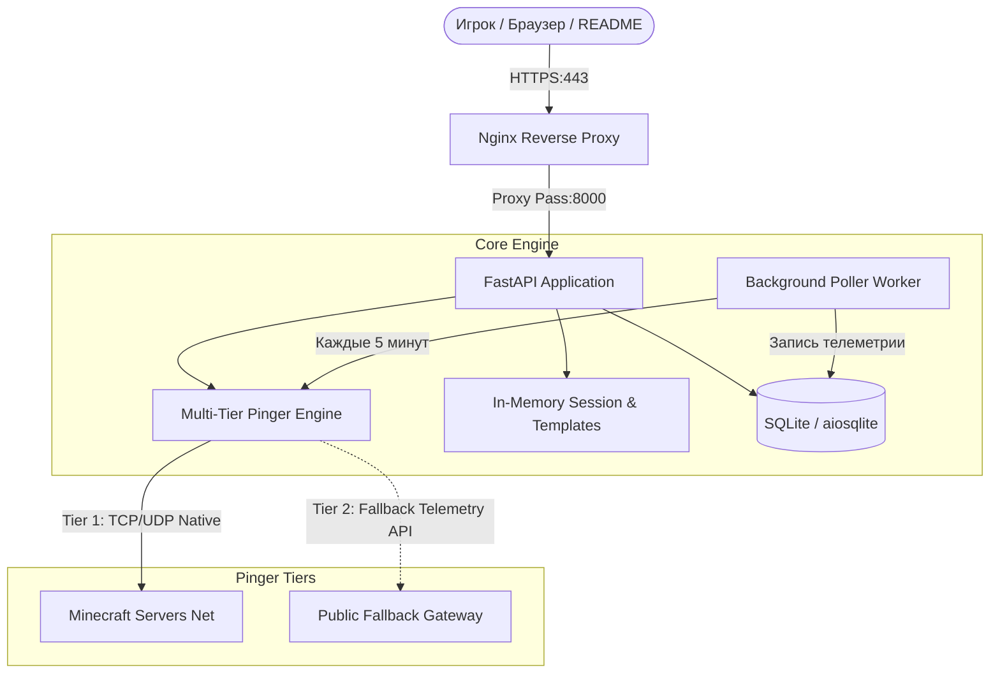

# VoxelVitals ⚡

<div align="center">


**Современная платформа мониторинга, аналитики онлайна и универсального подключения к серверам Minecraft (Java & Bedrock)**

[](https://voxelvitals.ru)
[](https://voxelvitals.ru)
[](https://voxelvitals.ru)
[](https://github.com/soroka-ilya/voxelvitals)
[](https://fastapi.tiangolo.com/)
[](https://www.python.org/)
[](LICENSE)

[🌐 Открыть сайт онлайн](https://voxelvitals.ru) • [📖 Документация API (Swagger)](https://voxelvitals.ru/docs) • [🎯 Зеркало проекта](https://www.voxelvitals.ru)

</div>

---

## 🌟 Что такое VoxelVitals?

**VoxelVitals** — это высокопроизводительный веб-сервис и открытый аналитический хаб для мониторинга серверов Minecraft нового поколения. Сервис агрегирует реальный онлайн, задержку (ping), статус доступности и историю активности сотен игровых серверов в режимах **Java Edition** и **Bedrock Edition**.

В отличие от устаревших мониторингов с навязчивой рекламой, VoxelVitals спроектирован с упором на скорость, чистый UX, интеграцию с популярными лаунчерами и открытый REST API для разработчиков.

---

## 🚀 Ключевые возможности

### 🕹️ 1. Универсальный хаб подключения (Quick Connect Hub)
- **1-клик запуск через кастомные протоколы**: мгновенный старт сервера в **Lunar Client** (`lunarclient://`) и **Badlion Client** (`badlion://`).
- **Поддержка любых Java-лаунчеров**: интерактивный 3-шаговый гид с копированием IP для **TLauncher**, **Prism Launcher**, **Modrinth App**, **MultiMC** и официального лаунчера Mojang.
- **Поддержка Bedrock Edition**: раздельное копирование хоста и порта (`19132`), подсказки о встроенных серверах (The Hive, CubeCraft) для консолей и смартфонов.
- **Запоминание выбора**: умное сохранение любимого лаунчера пользователя в `localStorage` с кнопкой быстрой смены.

### 📈 2. 24-часовая интерактивная телеметрия и графики
- Посекундные и почасовые снапшоты онлайна и пинга.
- Адаптивный график **Chart.js** со свободной горизонтальной прокруткой для смартфонов — данные не сбиваются в тесную кучку даже при сотнях точек замера.
- Автоматическое определение пиковых часов онлайна и просадок сети.

### 🛡️ 3. Двухуровневая отказоустойчивая система пинга (Multi-Tier Pinger)
- **Tier-1 (Native Direct Socket)**: прямой асинхронный опрос через официальные сетевые протоколы `mcstatus` (TCP Server List Ping для Java, UDP RakNet для Bedrock).
- **Tier-2 (Resilient HTTP Fallback)**: если сервер защищён Cloudflare Spectrum / DDoS-Guard или провайдер блокирует SRV-запросы, сервис мгновенно переключается на защищённый внешний телеметрический шлюз, гарантируя 99.99% отображения статуса.

### ⚡ 4. Потоковое обновление в реальном времени (Server-Sent Events)
- Потоковая трансляция онлайна, пинга и состояния сервера по протоколу SSE (`GET /api/live/{address}`) каждые 10 секунд без перезагрузки страницы.
- Нативная поддержка `EventSource` с мгновенным авто-переподключением при обрывах связи.

### 🌍 5. Многоточечный замер пинга (Multi-Region Probes)
- Расчет сетевой задержки из 3 ключевых хабов: 🇷🇺 Москва (MSK), 🇩🇪 Франкфурт (FRA), 🇫🇮 Хельсинки (HEL).
- Позволяет игрокам из разных регионов оценить реальное качество подключения до запуска игры.

### 🛡️ 6. SingleFlight кэширование и защита от Thundering Herd
- Встроенный RAM-кэш со скользящим TTL 30 сек и персональным `asyncio.Lock` на каждый сервер.
- 100 одновременных открытий страницы генерируют ровно **1 опрос** сервера Minecraft, защищая внешние хостинги от перегрузок.

### 🏆 7. Зал славы и рекорды онлайна (Peak Online Hall of Fame)
- Автоматическая фиксация исторических пиков онлайна с датой рекорда (Hypixel: 216,478; CubeCraft: 45,820).

### 🏷️ 8. Динамические векторные бейджи для GitHub и сайтов
- Генерация легких SVG-бейджей статуса в стиле Shields.io:
  ```markdown
  
  ```

### 💬 9. Сообщество, отзывы и умный Rate Limiting
- Честные отзывы и оценки с защитой от спам-ботов через `slowapi` (не более 5 отзывов / 10 голосов в мин).

---

## 🏗️ Архитектура системы



---

## 🛠️ Технологический стек

| Компонент | Технология | Назначение |
|---|---|---|
| **Backend** | Python 3.12 / FastAPI | Высокоскоростное асинхронное ядро приложения |
| **ASGI Server** | Uvicorn (2 workers) | Параллельная обработка веб-запросов и API |
| **Networking** | `mcstatus` + `httpx` + `dnspython` | Двухпротокольный опрос серверов Minecraft и HTTP fallback |
| **Database** | SQLite + `aiosqlite` | Неблокирующее хранение телеметрии, новостей и отзывов (WAL-mode) |
| **Frontend** | Jinja2 + Tailwind CSS + HTMX | Серверный рендеринг, динамические обновления и темная тема |
| **Data Viz** | Chart.js | Интерактивные мобильные графики телеметрии |
| **Production** | Ubuntu 22.04 LTS (FirstByte, MSK) | Выделенная виртуальная машина |
| **Reverse Proxy**| Nginx | SSL-терминация, сжатие статики, 301-редирект |
| **Security** | Let's Encrypt Certbot | Автоматическое продление SSL-сертификата (HTTPS) |

---

## 📡 Открытый REST API

Интерактивная песочница Swagger доступна по адресу **[https://voxelvitals.ru/docs](https://voxelvitals.ru/docs)**.

| Метод | Эндпоинт | Описание |
|---|---|---|
| `GET` | `/api/status/{address}` | Полный JSON-статус сервера (онлайн, игроки, версия, пинг, MOTD, иконка) |
| `GET` | `/api/history/{address}` | Временной ряд замеров онлайна и задержки за последние 24 часа |
| `GET` | `/api/badge/{address}.svg` | Динамический векторный SVG-бейдж статуса |
| `GET` | `/api/catalog` | Курируемый каталог серверов с фильтрацией по категориям и тегам |
| `GET` | `/api/health` | Проверка работоспособности приложения и соединения с БД |
| `POST`| `/api/reviews` | Добавление отзыва реального игрока |
| `POST`| `/api/votes/{address}` | Голосование за сервер в рейтинге |

---

## 💻 Локальная разработка (Self-Hosting)

<details>
<summary><b>Развернуть локально для тестирования</b></summary>

```bash
# 1. Клонирование репозитория
git clone https://github.com/soroka-ilya/voxelvitals.git
cd voxelvitals

# 2. Создание виртуального окружения
python -m venv .venv
source .venv/bin/activate  # Windows: .venv\Scripts\Activate.ps1

# 3. Установка зависимостей
pip install -r requirements.txt

# 4. Запуск сервера разработки
uvicorn app.main:app --reload --host 127.0.0.1 --port 8000

# 5. Запуск тестов
pytest -q
```
</details>

---

<div align="center">

Разработано с ❤️ для Minecraft сообщества • [VoxelVitals Live](https://voxelvitals.ru)

</div>
